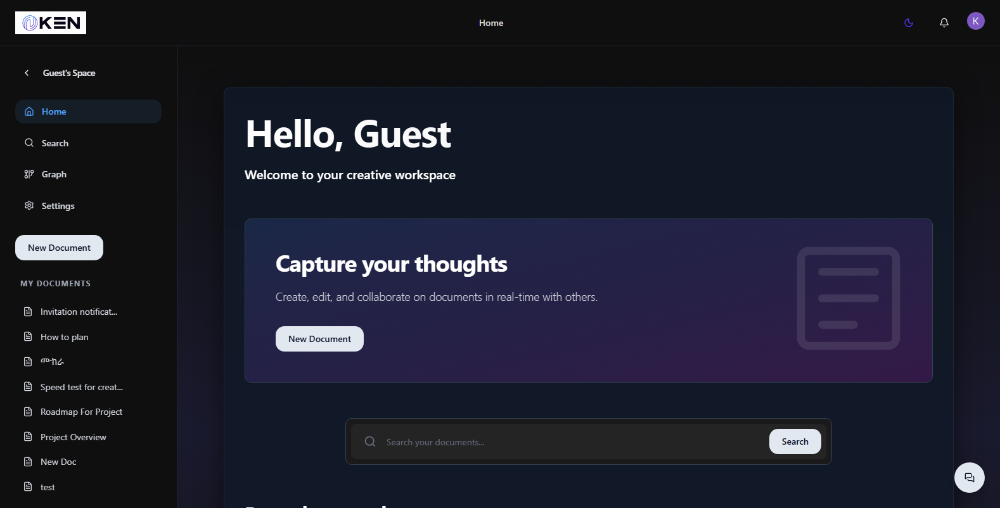
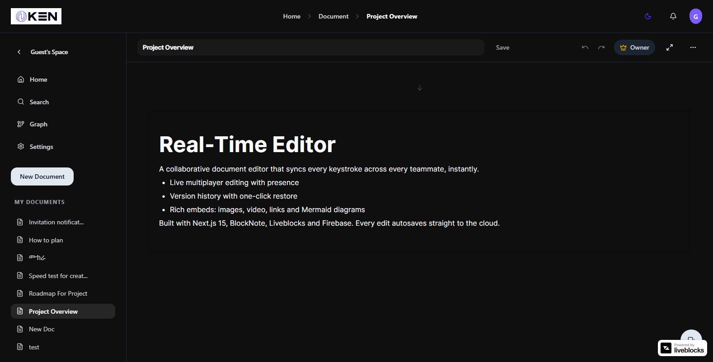
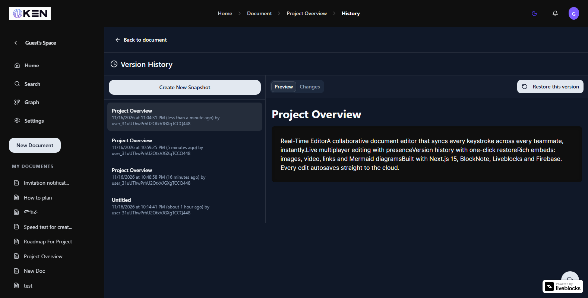
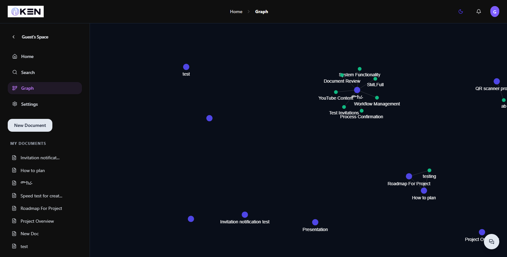

# KEN — Real-Time Editor

Documents that think in *sync*. KEN is a collaborative workspace where every
keystroke, comment, and version is shared the moment it happens — no "refresh
to see changes", no lost work, no version chaos.

**Live app:** https://real-time-editor-ashen.vercel.app/

---

## What it does

| | |
|---|---|
|  |  |
| *Your workspace at a glance — personal docs, shared docs, and quick actions.* | *A rich, block-based editor. Type `/` for anything: headings, images, videos, link previews, even Mermaid diagrams.* |
|  |  |
| *Every snapshot is kept. Compare, preview, and restore any version with one click.* | *Your workspace as a living graph — documents and the people/links connecting them, rendered with force-directed physics.* |

### Highlights

- **Real-time multiplayer editing** — presence, live cursors, and instant
  sync powered by Liveblocks and Yjs, on top of a BlockNote editor.
- **Version history** — automatic snapshots, side-by-side previews, and
  one-click restore. Nothing you write is ever final.
- **Rich embeds** — images, video embeds, link previews with real metadata,
  and Mermaid diagrams that render live inside the document.
- **Collaboration built in** — comments with resolution threads, per-document
  sharing with invites, and a "shared with me" view.
- **AI where it helps** — document chat, AI-assisted composition, and
  auto-generated tags. Bring your own key, or fall back to the server's.
- **Translation & answer grading** — a Cloudflare Worker (Workers AI) that
  summarizes + translates documents and evaluates answers.
- **Knowledge graph** — see how your documents relate to each other at a
  glance.

## Under the hood

| Layer | Tech |
|---|---|
| App | Next.js 15 (App Router), React 19, TypeScript, Tailwind CSS 4 |
| Editor | BlockNote 0.57 (ProseMirror) with custom blocks |
| Realtime | Liveblocks 3 + Yjs (CRDT), per-document rooms |
| Data | Firebase (Firestore + Admin SDK) with hardened security rules |
| Auth | Clerk |
| AI | Google Generative AI / OpenRouter (BYOK supported), Cloudflare Workers AI |
| Analytics | PostHog (optional) |

### Architecture in one breath

The browser talks to Liveblocks rooms for the *live* document, while Firestore
holds the *durable* copy — content autosaves server-side through Next.js server
actions, which are the only path that can write documents (browser writes are
locked down by security rules). Snapshots of every document live in a
`versions` subcollection, the AI endpoints sit behind `/api/*` routes, and the
Cloudflare worker in `V3/cloudflare` handles the heavy AI lifting off the main
server.

## Getting started

```bash
git clone https://github.com/kidus-23/real-time-editor.git
cd real-time-editor/V3/editor
npm install
cp .env.example .env.local   # fill in your keys
npm run dev
```

Open http://localhost:4000.

### Environment variables

Everything the app needs is documented inline in
[`V3/editor/.env.example`](V3/editor/.env.example):

- **Clerk** — `NEXT_PUBLIC_CLERK_PUBLISHABLE_KEY`, `CLERK_SECRET_KEY`
- **Liveblocks** — `NEXT_PUBLIC_LIVEBLOCKS_PUBLIC_KEY`, `LIVEBLOCKS_PRIVATE_KEY`
- **Firebase Admin** — `FIREBASE_SERVICE_ACCOUNT_KEY` (stringified service account)
- **AI** — `GOOGLE_AI_API_KEY` / `OPENROUTER_API_KEY` (optional, BYOK supported)
- **PostHog** — `NEXT_PUBLIC_POSTHOG_KEY` (optional)

### Firebase rules

`firestore.rules` ships with the repo — documents and version history are
readable, but every write goes through server actions with verified room
membership. Deploy with `firebase deploy --only firestore:rules`.

## Repository layout

```
V3/editor       # the Next.js app (this is what Vercel deploys)
V3/cloudflare   # Cloudflare Worker: translation + answer evaluation
firestore.rules # security rules for Firestore
```

## Notes

- Clerk is currently running with development keys in the deployed
  environment — the console warning is expected until production keys are
  configured.
- The live Liveblocks room is the session's working copy; the durable copy is
  what the autosave writes to Firestore. Always trust the version history to
  have your back.

---

Built by [kidus-23](https://github.com/kidus-23). License: [MIT](LICENSE).
